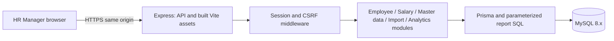

# Architecture — approved design

Approved by the user for Milestone 1 on 2026-10-15. The design-stage descriptions below are preserved; implementation evidence and remaining live checks are tracked in [milestone-1.md](milestone-1.md).

## Scope and deployment shape

A modular monolith serves one HR Manager and 10,000 synthetic employees. Keep the selected stack: React, TypeScript, Vite, Tailwind CSS, shadcn/ui and Recharts; Node.js, Express and TypeScript; Zod; Prisma; MySQL 8.x; Vitest and Supertest. No application scaffolding, dependency installation or deployment is part of this design milestone.

Prefer one HTTPS origin: Express serves built frontend assets and `/api/v1`. A managed MySQL service is separate infrastructure, not a separate application service. Vite proxies `/api` locally. This avoids cross-origin cookies in the initial deployment. Hosting provider remains an implementation/deployment decision; no service is selected or deployed here.

## Proposed repository boundaries

| Area | Responsibility |
|---|---|
| `client/src/features/{auth,employees,salaries,analytics,imports,master-data}` | Pages, forms, table filters, charts and API adapters grouped by feature |
| `client/src/components`, `client/src/lib` | Reusable UI, fetch wrapper, date/money formatting; no business aggregation |
| `server/src/app.ts` | Assemble Express middleware/routes; independent of listening port for Supertest |
| `server/src/modules/{auth,employees,salaries,master-data,analytics,imports}` | Zod request schemas, route/controller, use-case service; repositories only where meaningful |
| `server/src/lib` | Prisma client, request clock, decimal conversion, errors, session/CSRF helpers and configuration |
| `server/prisma` | Approved schema, reviewed migrations and deterministic seed, created later |
| `server/test` | Unit/API/integration fixtures, MySQL helpers and repeatable performance harness |
| `docs`, `prompts` | Requirements, contracts, evidence, decisions and actual AI prompts |

Avoid generic repository frameworks, CQRS, event buses, microservices, queues or Redis. Controllers translate HTTP and validate inputs; services own business rules and transaction boundaries. Ordinary reads/writes use Prisma. Analytics SQL stays in one small repository with bound parameters and an allowlist for grouping/sorting SQL fragments. Frontend types mirror API contracts; do not expose ORM records or database Decimal objects directly.

Frontend server state always comes from paginated APIs. Filters and reporting currency/date are explicit UI controls. Employee detail separates current, historical and scheduled salary. Inactive state remains visible. Import preview/result UI shows every row outcome; the server remains authoritative. Reports display selected currency, salary-as-of date and actual FX date/source, illustrative-rate label, and no-current-salary counts. Do not sum charts locally or imply payroll spending/historical assignment accuracy.

## Authentication and request security

Seed one HR account with an environment-supplied password hashed using argon2id. Never place credentials in source or logs. Generate a cryptographically random opaque session token; store its SHA-256 hash, associated user, separate random CSRF token and eight-hour absolute expiry in MySQL. Cookie holds only the raw random session token, HttpOnly, Secure in HTTPS production, SameSite=Lax, Path=/, no Domain. Use a production `__Host-` cookie name; local HTTP uses a separate non-prefixed name and Secure=false. Rotate the token at login; delete on logout and periodically remove expired sessions. Authorization checks expiry server-side on every data route.

Use one small authentication module with direct session lookup middleware and CSRF/origin middleware; no auth-provider interface, JWT/refresh-token system, anonymous sessions, custom HMAC token derivation or general policy framework. At login generate a separate random 32-byte CSRF token, store it as hex in the session row and return it in JSON. It is not an authentication credential: it is usable only alongside the HttpOnly session cookie. GET session/CSRF returns the same token, without rotating it and breaking other tabs. Compare tokens in constant time and rotate both tokens on login; revoke the old session if present.

Authenticated mutations, including logout and multipart import, require that session's X-CSRF-Token plus an exact allowed Origin. Login requires exact Origin validation and application/json, rejecting form/text content types; browser forms cannot satisfy JSON-only input and cross-origin scripts cannot pass a disallowed CORS preflight. Reject absent/null/untrusted Origin for all browser-only mutations. Keep CORS disabled in the same-origin deployment. This protects login without a second anonymous-cookie lifecycle. HttpOnly/Secure/SameSite cookies, password hashing, expiry and login limiting remain required.

If deployment needs different frontend/API origins, explicitly configure one allowed frontend origin, credentialed CORS and CSRF origin validation; choose cookie SameSite based on whether the origins are cross-site (cross-site requires None and Secure). Revisit this only against the concrete hosting plan. Do not use wildcard credentialed CORS.

Use JSON body size limit 64 KiB, CSV limit 5 MiB/10,000 records, login rate limiting, parameterized SQL, secure response headers and a production CSP tested with the frontend. Avoid logging names, emails, salaries, upload contents, passwords or tokens. Log request ID, route template, status and duration. Public health reveals only availability. Environment validation must fail at startup for missing secrets/database URL/allowed origin. Runtime DB credentials cannot mutate salary history; migration credentials are separate.

## Transactions, concurrency and calculations

Employee plus initial salary is one transaction. CSV is one transaction per accepted row, never one transaction for the whole file. Preflight syntax/limits/duplicate scan is bounded in memory before writes. Existing employee writes serialize using row locks when checking dependent state. Unique keys, FK constraints and SQL checks enforce invariants even when requests overlap. Handle duplicate key errors as domain conflicts or CSV reread/reclassification.

Every salary insertion checks active status and effectiveDate >= hireDate under an employee row lock. Hire-date edits reject a date later than any existing revision; deactivation takes the same lock. CSV unchanged replay remains a no-write skip for inactive employees. Future hires/revisions are allowed; future hires have no current salary until a valid revision becomes effective. Already-scheduled records survive deactivation and default analytics still excludes the employee.

Current salaries are computed by effective date on every request. No daily rollover job, cached current-salary column or refresh process is required. A request-scoped UTC clock makes tests deterministic and avoids split-midnight responses. Only calendar dates cross salary API boundaries. Read transactions give analytics/counts consistent snapshots when needed.

Cross-currency calculations multiply amount by target rate before dividing by source rate, with explicit intermediate casts and DECIMAL(65,24) computation values as specified in [database design](database-design.md). Verify div_precision_increment=4 on each pooled reporting connection and check numeric warnings; displayed factors do not drive aggregation. Documentation-based arithmetic verification is complete; pinned-MySQL execution and extreme-value/aggregate tests remain required. No analytics cache initially: cached rates are database rows, not live requests. A future cache would require salary/master changes and UTC rollover invalidation, so defer it unless measurements justify it.

## Deterministic seed proposal

Fixed random seed and fixed documented reference date (proposed 2026-10-15); stable employee codes EMP00001 through EMP10000. Seed multiple countries, departments/designations, supported currencies, realistic synthetic names and varying salary ranges, zero/no-current cases, inactive employees, historical and future revisions relative to the fixture date. All salary fixtures must be on/after hireDate; insert history while an employee is active before deactivating the fixture. Ensure a guaranteed future fixture can be generated for date-controlled tests; a fixed demo seed naturally ages and must not pretend otherwise.

Seed uses an explicitly approved empty demo/test database and is insert-only in a transaction: refuse a nonempty application dataset rather than silently wiping or overwriting salary history. No destructive reset in normal seed. Document explicit reset separately, requiring approval; no automatic production reset. Seed HR credentials come from environment, and dated illustrative rates use a labeled source. Stable input means stable rows, except password hashing salts/operational timestamps; deterministic tests do not assert those bytes. Verify exactly 10,000 employees, valid references and expected revision totals after seed.

## Verification and performance plan

1. Fast Vitest units: UTC date classification, decimal conversions/rounding, missing-rate rules, input schemas and CSV normalization/duplicate policy. Inject time and use known fixtures.
2. Supertest plus isolated real MySQL: cookie/CSRF login/logout/expiry, all protected routes, employee+salary rollback, append-only conflicts, pre-hire/inactive insertion rejection, hire-date/history consistency and deactivation races, import idempotency/partial success/concurrency, SQL median/distribution and unique/FK/CHECK constraints. SQLite is not a substitute for MySQL integration behavior.
3. Frontend checks: TypeScript/lint, focused component behavior for salary classifications, report unavailable state and row-error presentation; manual smoke of the main HR journey.
4. Performance: seed 10,000 employees with documented revision counts, record commit, Node/MySQL versions, hardware/container limits, indexes, database network placement and execution plans. Run warmed authenticated list and analytics cases for at least 1,000 requests per case at concurrency 10; report cold-start separately. Include unfiltered and combined filters, late pagination, contains search, grouped median/distribution and multiple currencies. Measure end-to-end API latency, p50/p95/max/error counts, not only SQL duration; goal p95 <500 ms for each common route case. Measure import duration separately and choose HTTP/proxy timeout based on evidence.

No performance target has been verified in this documentation milestone. Run relevant tests and lint/typecheck after each implementation milestone. Do not add a cache or more services before evidence identifies a bottleneck.

## Implementation milestones after design approval

1. Scaffold monorepo, pin versions, implement approved Prisma schema/migrations and deterministic seed; inspect generated SQL and validate database constraints.
2. Implement auth/CSRF and master/employee APIs with integration tests; basic login and employee UI.
3. Implement append-only salaries and their UI, currency selection and database analytics with deterministic tests.
4. Implement CSV validation/import/results and idempotency tests; complete HR journeys.
5. Measure performance, address evidence-backed issues, document reproducible setup/deployment, obtain explicit deployment approval, deploy and record demonstration.

Each milestone updates AI usage, meaningful prompts, decisions and README commands. Commits/pushes/deployment require explicit user approval. Design approval is required before scaffolding under AGENTS.md.

## Known limits and review points

No salary correction workflow, assignment/status history, historical headcount reconstruction, payroll, live FX, XLSX, exports or multi-role administration. Fixed-point conversion is finite precision, and rounded grouped totals may differ by a cent from a rounded overall total. Offset pagination may shift during concurrent edits; master edits are last-write-wins. Synchronous 10,000-row imports may exceed client, proxy, load-balancer or application timeouts after some rows have committed. A gateway timeout may prevent any row-results response; UI must show unknown/incomplete outcome and support deliberate idempotent re-import. Measure import duration and align host deadlines before accepting this limit. Keep whole-file duplicate detection and row transactions; do not silently split files. If the host cannot support the measured duration, obtain a separate decision on a lower limit or background jobs. Country names/codes and currency catalog require a maintained seed allowlist. No application dependency/version compatibility has yet been tested.
